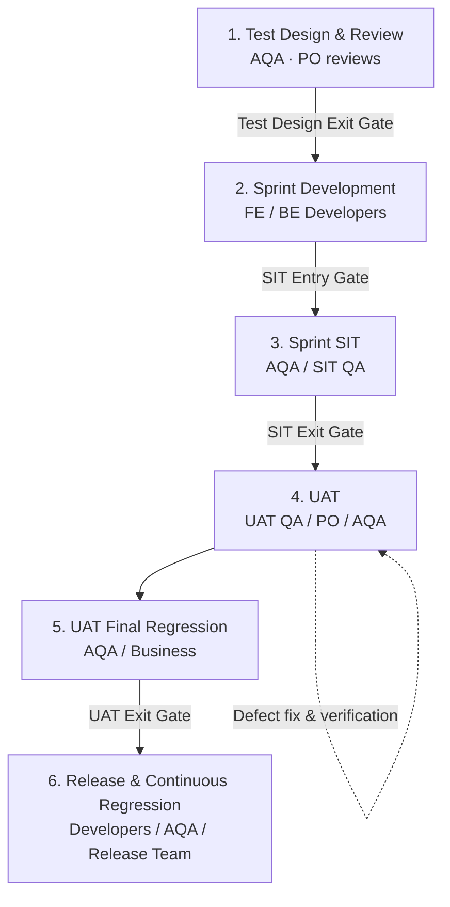

# Test Process for a financial technology company

A QA delivery workflow in six phases, from test design to release. Each phase
has an owner, and most phases end with a gate.

## Phase 1: Test Design & Review

Owner: AQA. Reviewer: PO.

| AQA | Product Owner |
|---|---|
| Analyze the requirements and business rules | Review the AT and the SIT test cases |
| **Define the Acceptance Tests (AT)** | Validate the business coverage |
| Design the SIT test cases | Clarify the requirements |
| Identify the automation candidates | Approve the Acceptance Tests |

**Test Design Exit Gate:** the PO reviewed and approved the AT and the SIT test
cases.

## Phase 2: Sprint Development

Owner: FE and BE developers.

| FE developer | BE developer |
|---|---|
| Mocked UI end-to-end tests | Unit and API tests |
| Component integration tests | Service integration tests |
| Contract tests | Contract tests |

**SIT Entry Gate:** the developer tests passed. The environment and the test
data are ready.

## Phase 3: Sprint SIT

Owner: AQA and SIT QA.

- **Rapid functional validation:** run the SIT test cases. Validate the core
  features and the real integration between systems.
- **Exploratory testing:** test more negative, corner, and exception
  scenarios.
- **SIT automation:** complete the sprint automation and add it to the SIT
  regression suite.

**SIT Exit Gate:** the functional, integration, and SIT regression tests
passed. The owners accepted the remaining risks.

## Phase 4: UAT

Owner: UAT QA, PO, and AQA.

| UAT QA / PO | AQA |
|---|---|
| Run the business acceptance tests | **Add the user journeys that the PO defines to the UAT regression suite** |
| Verify and retest the defect fixes | Reuse and combine the automation scripts |
| Keep the business test evidence | Debug and validate the scripts in UAT |

**Defect fix and verification:** a developer fixes the defect. UAT QA retests
it. AQA runs the regression tests for the changed areas.

## Phase 5: UAT Final Regression

Owner: AQA and the business.

- Run the automated user journey regression suite.
- Verify the defect fixes and the regression results.
- Make the regression reports and the test evidence.

**UAT Exit Gate:** the regression passed. The team resolved or accepted all
critical defects. The business signed off.

## Phase 6: Release & Continuous Regression

Owner: developers, AQA, and the release team.

- Check release readiness, and deploy to production.
- Reuse the SIT and UAT regression suites in each release.
- Run regression for each change through CI/CD.
- Keep the automation coverage complete and the tests reliable.

## Ownership summary

| Role | Responsibility |
|---|---|
| AQA / PO | Test design and business coverage review |
| Developers | Component, API, and service integration quality |
| SIT AQA | System validation and SIT automation |
| UAT QA / PO | Business validation and acceptance |
| AQA regression | User journey automation and continuous regression |

## Notes

- AQA defines the Acceptance Tests (AT). The PO reviews and approves them. UAT
  QA does the business acceptance.
- SIT and UAT have separate regression gates.
- Defect retests and regression for each change happen in all phases.
- SIT can follow the sprint cycle, and UAT can follow the release cycle. This
  works only when the team controls the builds and the environments.

[Back to home](../README.md)
