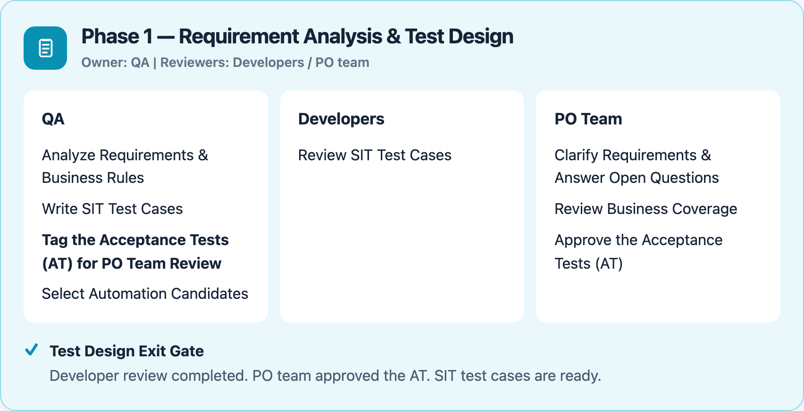
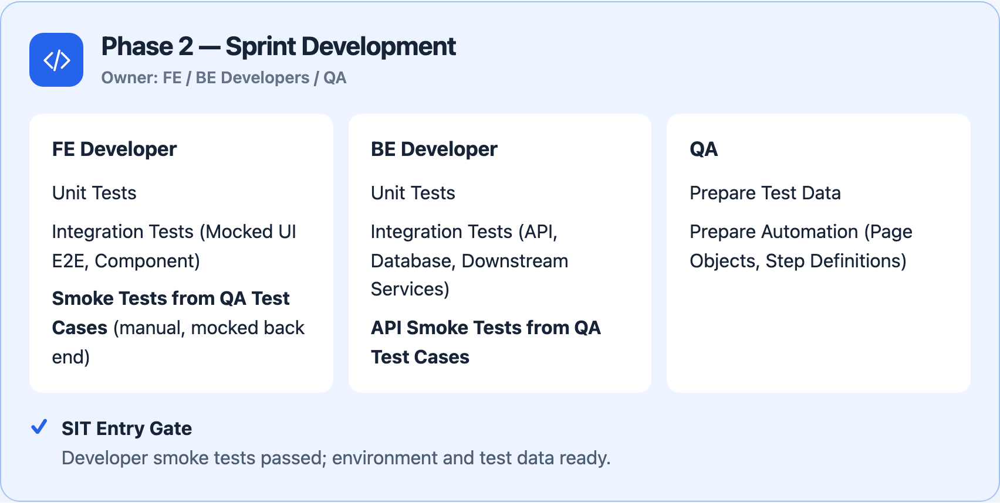
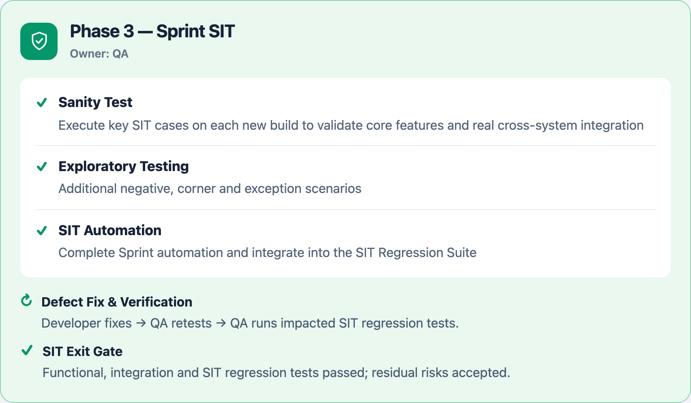
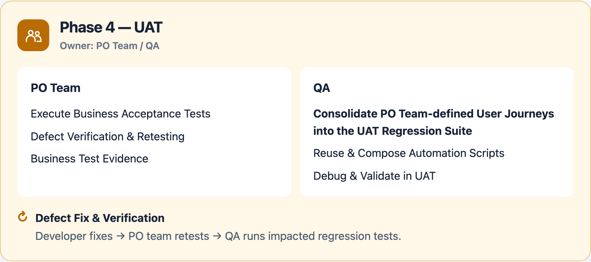
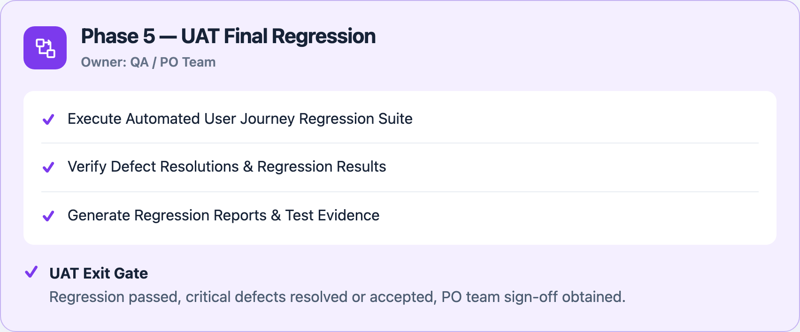
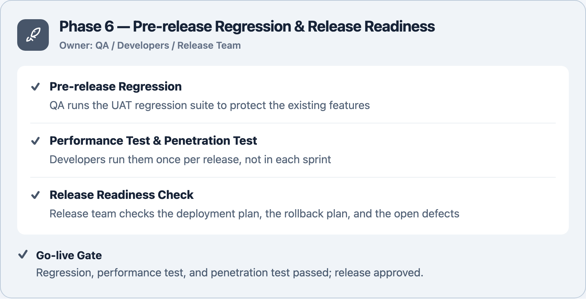
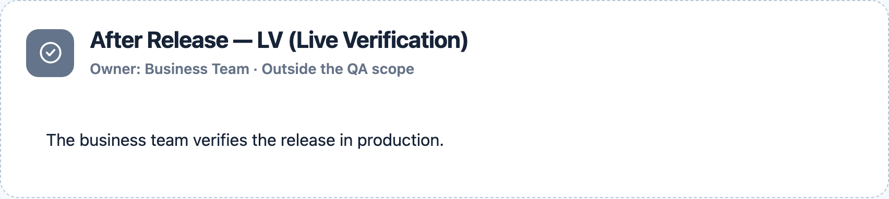
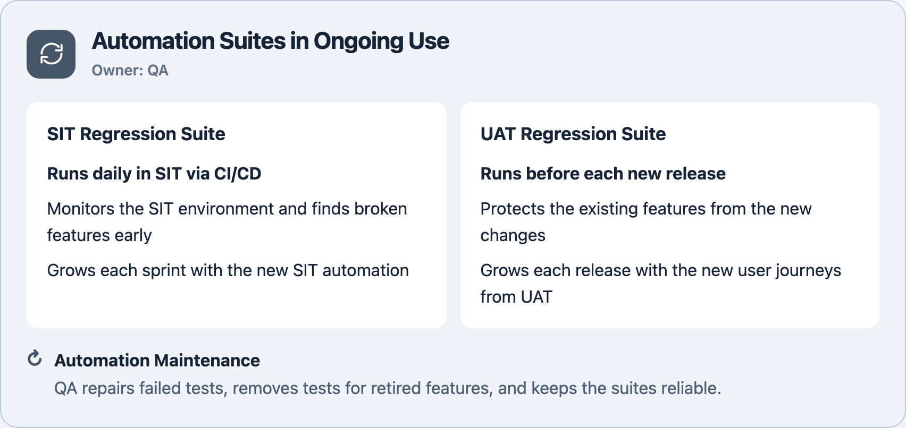
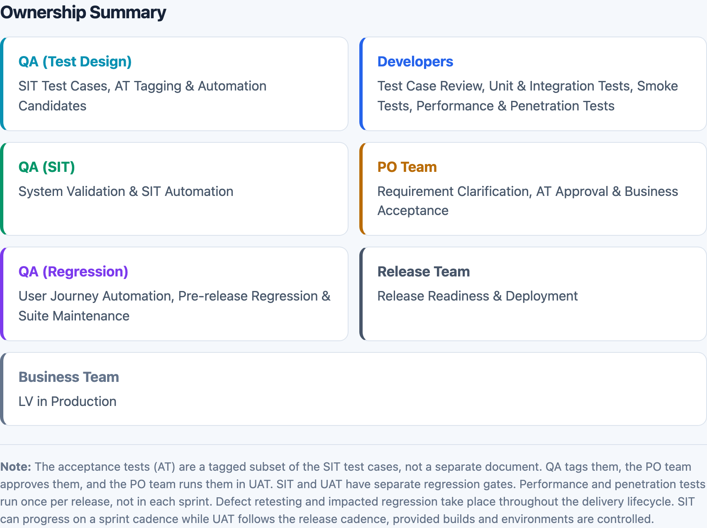

# Test Process for a financial technology company

A stage-by-stage view of the test process. Each stage shows its owners, tasks, and quality gates.

[Download PDF](test-process.pdf) · [Full-size image](../assets/test-process.png) · [HTML source](test-process.html)

The PDF supports zooming and text selection. Download the HTML and open it in a browser for the responsive version.

[Back to home](../README.md)
